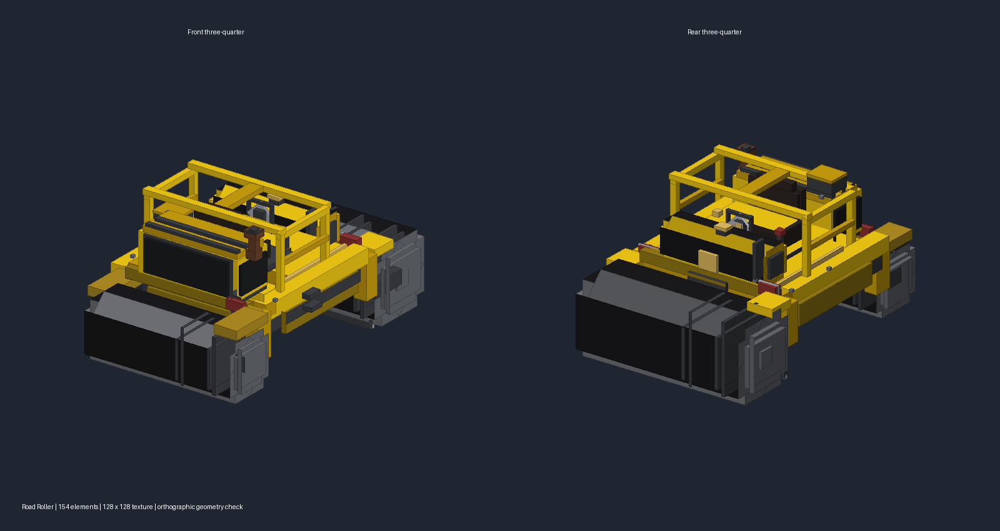

# DIO 压路机

模型包含 154 个部件与 128×128 专用像素贴图：双金属滚筒、轮毂与螺栓、黄色机架、驾驶座与方向盘、护栏、进气格栅及排气管。世界表现为约 4×3×6 格，物品栏与手持使用独立显示变换。

## 已确认的规则

- DIO 商店 200 金币，购买冷却 90 秒，使用冷却 150 秒，二者独立。
- 仅允许在本人发起且仍生效的时停中释放；成功消耗 1 个，失败不消耗。
- 以原位置为中心抬升 30 格，给玩家身体预留空间，不能超过当前可玩区域及世界高度上限。
- 短暂蓄势后向下加速，穿过中间楼层，终点为半径 5 格覆盖范围内、地图可玩区域中的最底层碰撞地板。
- DIO 在模型顶端俯身双手下压；运动由服务器接管，禁用玩家手动位移、重力及碰撞推挤。
- 压路机动作期间，经 `AllowOtherCameraType` 许可事件绕过局内第一人称限制，DIO 自动使用后置第三人称；动作结束、提前中断、断线或换世界时恢复释放前的视角。
- 下砸的半径 5 格扫掠范围内，其他存活玩家经游戏原有死亡流程结算（保留护盾等死亡事件），成功击杀播放机械碾压音效和粒子。
- **压路机动作结束（通常40 tick）立即回到使用压路机前的位置与朝向，不等待时停结束**，并清零坠落距离；专用 RETURN 消息同步更新客户端时停位置快照。时停提前结束、断线或服务端关闭也清理；死亡/换维度/结算不覆盖系统自己的传送。
- 方块只是客户端渲染隐藏：服务器地形、碰撞、方块实体及容器内容始终保留。5 秒后从底部开始，约 3 秒内分批恢复可见；切换世界、断线与回合结束立即清理。
- 撞击与击杀生成爆炸闪光、爆炸粒子、环形烟尘；下砸穿层和最终落地会弹起带原方块材质的旋转碎块，按抛物线散落并缩小消失。碎块仅客户端渲染（最多160个），时停期间照常运动，不生成服务器实体。

## 实现入口

- `game/dio/RoadRollerAttack`：商店及服务端生命周期；`DIORoleData`：冷却与释放状态。
- `game/dio/RoadRollerMotion`：两端轨迹、球体扫掠计算。
- `client/RoadRollerClient`：轨迹模型、碎屑、引用计数、分批重建。
- 原版与 Sodium 网格钩子均只替换渲染查询；方块实体渲染单独隐藏。
- 特效广播使用一条轨迹包，不逐方块发包；粒子形状在客户端生成。
- 1.21.1 的 `LevelRenderer.setSectionDirty` 使用 `SectionPos.x/y/z`，不是方块坐标；临时隐藏与恢复按区块节合并刷新，含相邻节的边界面。
- 时停的旧位置/动画锁定对正在下砸的 DIO 单独放行；最终回位仅由服务端传送，客户端不覆盖回溯坐标。

## 游戏内验收

1. 非 DIO、非本人时停、冷却中、乘坐中或剩余时停不足时右键：无位移、不消耗物品。
2. 200 金币购买成功，90 秒内不能再买；释放消耗一个，150 秒内即使买到新物品也不能再次释放。
3. 多层地图上释放：确认规则启用时仍为第三人称；抬升不越界，DIO 俯身位于压路机上，穿层到达底层后立即回到释放前位置（此时时停仍剩余），不产生坠落伤害；落地可见爆炸烟尘与方块飞溅。
4. 下砸路径中的玩家命中，半径外及远处上下楼层未扫到的玩家不误杀；每个成功击杀各有音效与粒子。
5. 其他客户端看见半径 5 格破坏，服务器方块/箱子内容不变；结束未满 5 秒不恢复，随后逐渐恢复。
6. 原版和 Sodium 渲染分别验证，确认箱子、告示牌、水体无残留；动作中结束时停、断线、换图后没有残留隐藏或无重力。
