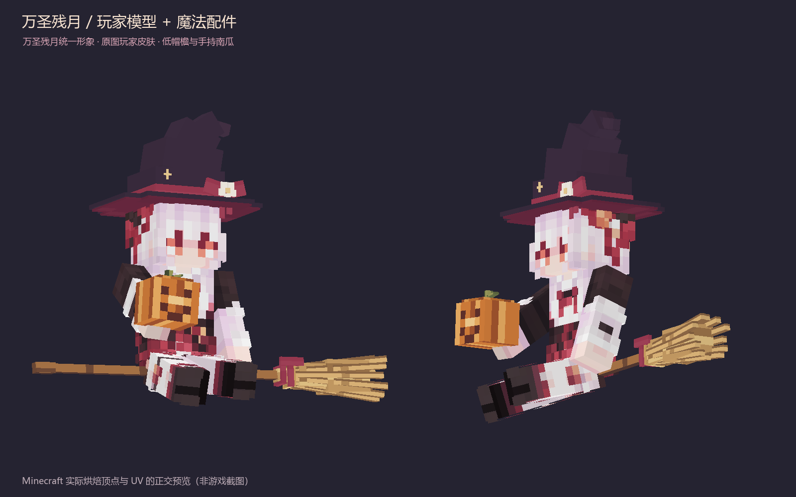

# 万圣残月 · 玩家模型、魔女帽、扫帚与南瓜



[头部近景](images/halloween-canyue-face.png) · [背面与另一侧](images/halloween-canyue-back.png)

## 当前造型

人物直接使用 **原版 Alex 细手臂 PlayerModel**，原版 8×8×8 方头、身体、双臂双腿与皮肤外层均保留。使用用户提供的 64×64 RGBA 皮肤原文件，不重画脸、不换色、不裁切、不自定义人物体型。

固定兑换 NPC 与原“糖果使者”现在统一名称和形象，均使用万圣残月玩家皮肤、魔女帽、扫帚和右手托举的刻脸南瓜。只统一外观，**不合并交互规则**：敲门生成的临时残月仍限时存在、全服成功领糖一次后消失，固定残月继续兑换和魂契交互。`isCandy` 仍作为服务端交互状态，不再控制皮肤或名字。

帽子在头部局部坐标下压 1.25 模型像素，轻盖头顶头发但不遮眼；帽身改为有层次的紫黑色，酒红衬里与红帽带采用不同色区。南瓜使用橙色棱纹、像素刻脸和青色瓜蒂；绑定右臂并反向补偿手臂前倾，让南瓜托在掌心。配件仍使用独立 128×128 图集，不覆盖或修改原玩家皮肤。所有部位整体轻微悬浮。

原先的自绘人物 `.geo.json` 和图集不再由此渲染器加载，启动不再经过自定义人物骨骼解析。NPC 交互箱、交易、魂契与服务端逻辑不变；帽子和扫帚的额外宽高只影响展示。

## 当前资源和代码

- 玩家皮肤：`src/main/resources/assets/noellesroles/textures/entity/halloween_canyue_skin.png`
- 配件贴图：`src/main/resources/assets/noellesroles/textures/entity/halloween_canyue_accessories.png`
- 人物：`HalloweenWitchModel.java`，直接调用 `PlayerModel.createMesh(..., true)`。
- 配件几何：`HalloweenWitchAccessories.java`，原版 `LayerDefinition`，独立配件渲染层。
- 渲染器：`VillageNpcRenderer.java`，两种交互身份共用同一个模型、皮肤和配件层，无八倍缩放或独立头脸几何。

修改帽子、扫帚形状时编辑 Java 配件网格；修改颜色时编辑脚本内 `REGIONS`。生成脚本永远不写玩家皮肤。

## 验证与预览

```bash
python -X utf8 tools/generate_halloween_witch.py --texture
./gradlew --offline test --tests '*HalloweenWitchModelTest'
python -X utf8 tools/test_halloween_witch.py
python -X utf8 tools/generate_halloween_witch.py --preview
```

Java 测试实际构造原版玩家和配件模型，验证玩家比例、细手臂、皮肤外层同步、帽子跟头而扫帚不跟头、下压偏移不累积、南瓜跟手且保持竖直、旧发糖名称翻译统一，以及实际顶点 UV 边界和图集采样。测试导出 `build/halloween-witch-preview-mesh.json`，预览直接使用 Minecraft 输出的四边形与 UV。

Python 检查皮肤 SHA256 与用户原文件一致、透明区域与配件贴图再生成一致。预览不是游戏截图；游戏内悬浮、视角遮挡、资源重载和原有右键交互仍需人工验收。Java 改动须重新打包并重启，不能只按 F3+T。
